<div align="center">

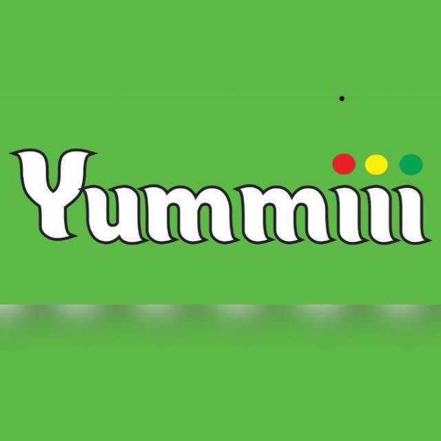

# Yummiii

**A full-stack online shop with Cash on Delivery: React frontend, Laravel API, MySQL, Docker.**
Built for a real family food business in Sri Lanka 🇱🇰

[](https://github.com/mohamadayoobzawahir-png/yummiii/actions/workflows/ci.yml)


### 👉 [Live demo: yummiii-demo.onrender.com](https://yummiii-demo.onrender.com)

**Demo admin:** `demo@yummiii.app` / `demo1234` ([open the admin panel](https://yummiii-demo.onrender.com/admin/login))
<br><sub>Hosted on a free plan: the first visit may take up to a minute while the site wakes up. The demo resets with fresh sample data every time it starts.</sub>

</div>

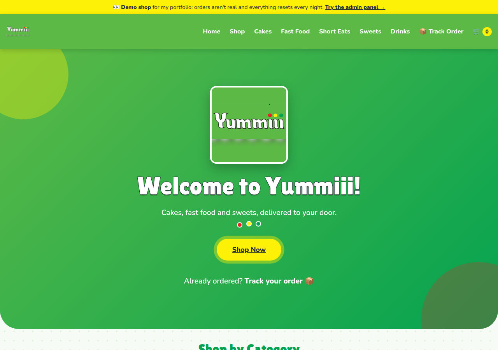

## Features

### For customers

- **Shop by category**, today's **offers** (with discount badges) and **best sellers** on the home page
- **Search, sort and filter**: by price, best selling, offers only
- **Cart** that can't exceed the available stock, saved across visits
- **Guest checkout, Cash on Delivery**: delivery fee by area, no account needed
- **Track my order** with the order number and mobile number

### For the shop owner (admin)

- **Dashboard**: cash collected and still to collect, orders today, best sellers, low-stock alerts, last 7 days of sales
- **Orders**: confirm → out for delivery → delivered (or cancel), one tap to call the customer
- **Sales reports** by day, week, month or year, with **Excel (.xlsx) download**
- **Stock monitoring**: level bars, low/out alerts, and a full **stock history** (who changed what, and why)
- **Products and categories**: photos, offer prices, stock levels, emoji categories you can reorder

## Screenshots

| Offers on the home page | Shop |
|---|---|
| 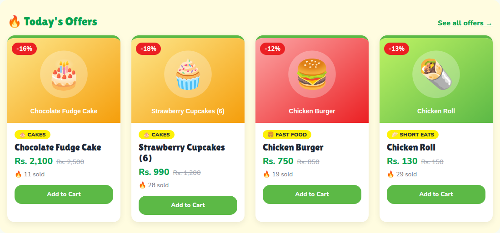 | 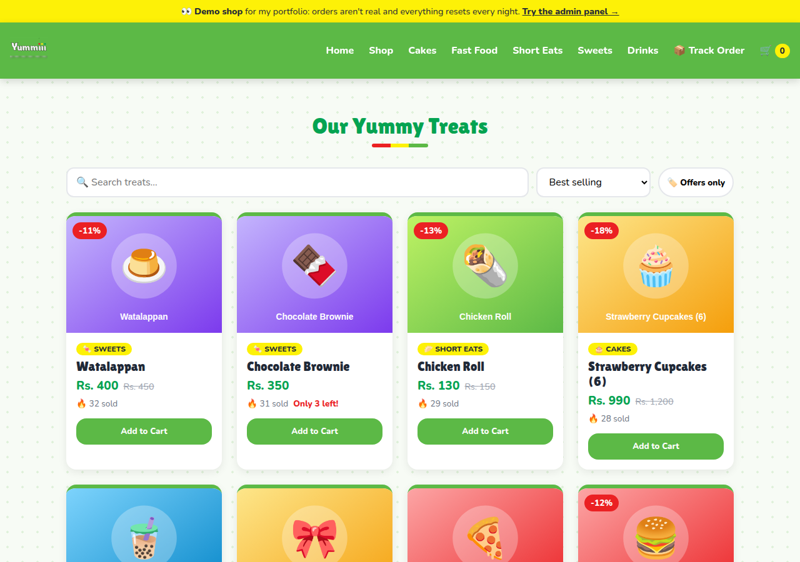 |
| **Admin dashboard** | **Sales report + Excel export** |
| 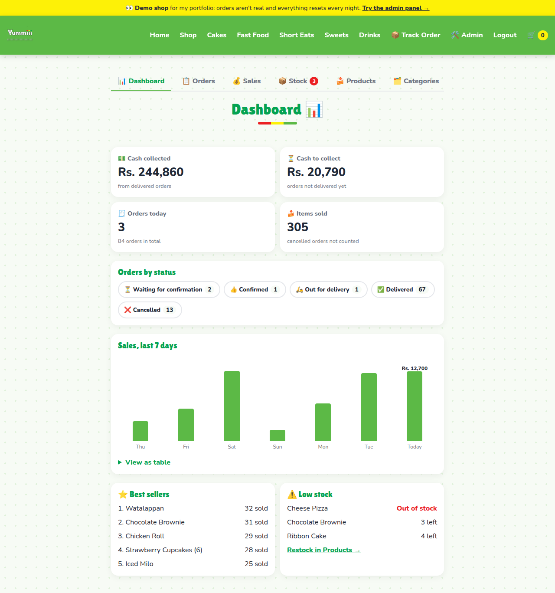 | 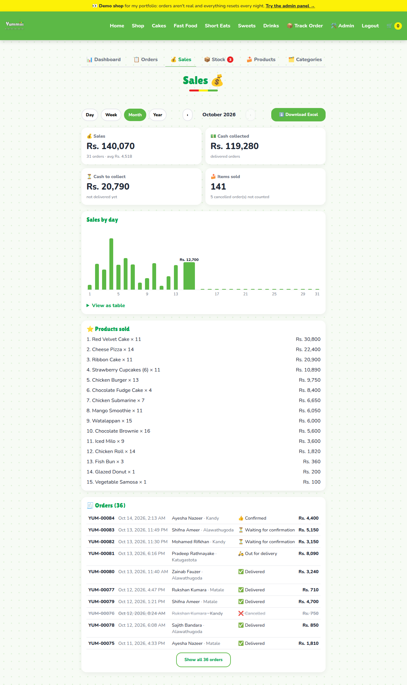 |
| **Stock levels** | **Stock history** |
| 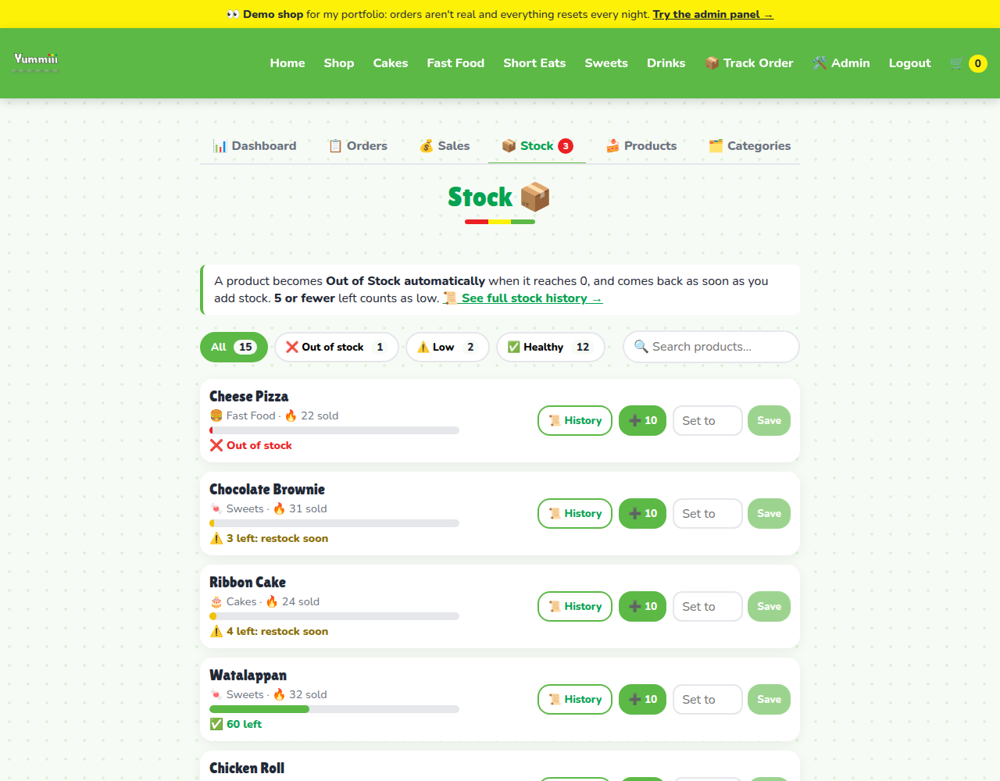 | 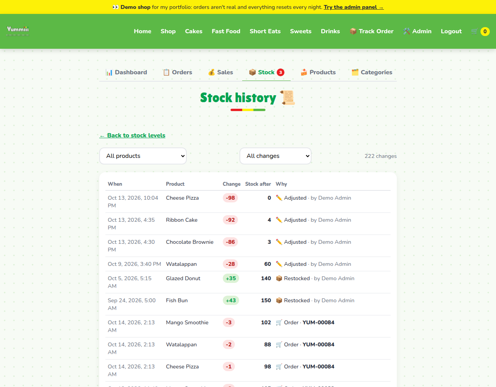 |
| **Order management** | **Track my order** |
| 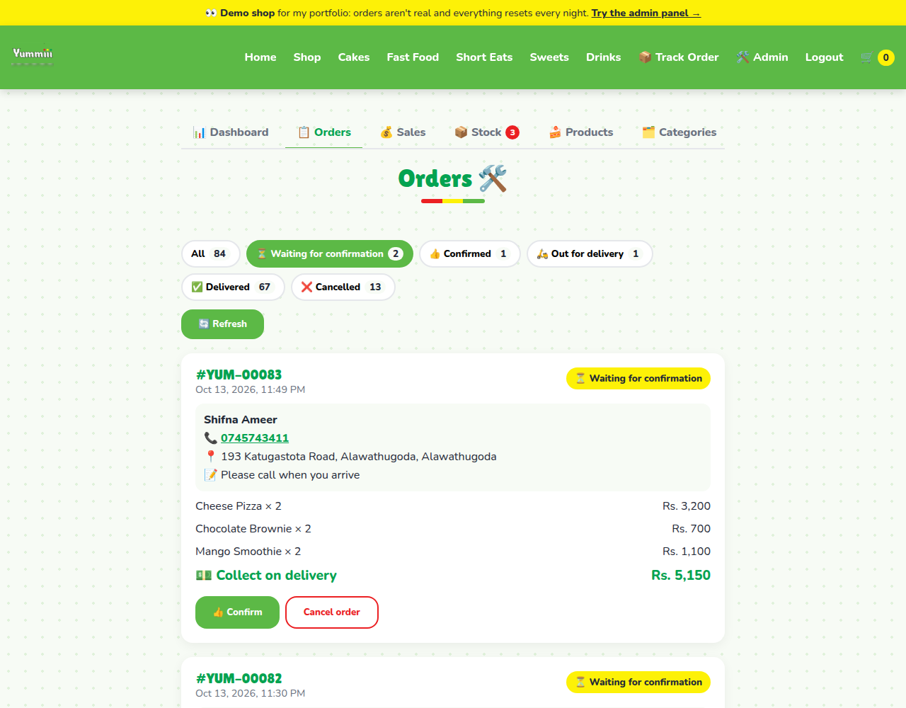 | 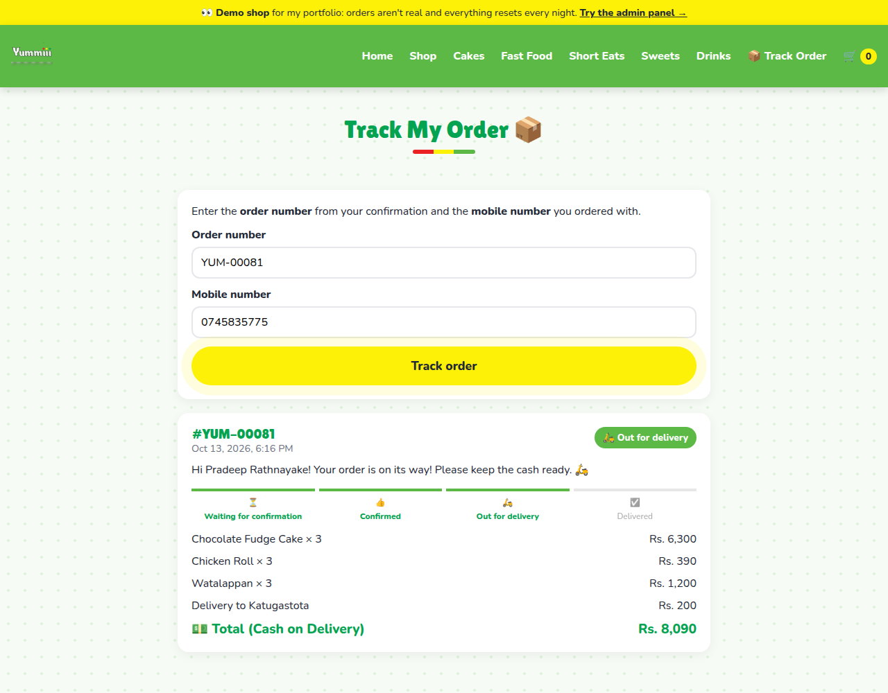 |

<p align="center">
  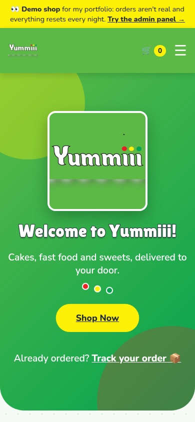
  &nbsp;&nbsp;
  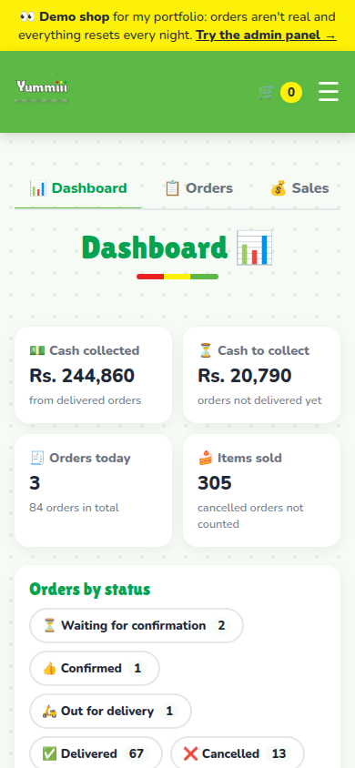
</p>

## Engineering highlights

- **The server decides every price.** The browser only sends product IDs and quantities; Laravel looks up prices and offers, so editing the cart in DevTools can't change what a customer pays.
- **No overselling.** Stock is checked and reduced inside a database transaction with row locks (`lockForUpdate`), so two people can't buy the last cake at the same moment. A failed order takes no stock at all.
- **Out of stock is calculated, not stored**, so it can never be wrong: a product flips to "Out of Stock" the moment its stock reaches 0.
- **An audit trail for stock.** Every change goes through one method (`Product::changeStock()`) that also writes the stock history, so there are no gaps.
- **Security by default.** Admin-only login with expiring Sanctum tokens, `is_admin` is never mass-assignable, rate limits on login, ordering and order tracking, identical error messages that don't reveal which accounts or orders exist, and debug details hidden in production.
- **One codebase, two sites.** `DEMO_MODE=true` turns a copy into this public portfolio demo with fake data that resets nightly. The reset command refuses to run on the real shop.
- **Tested.** 23 feature tests (pricing, stock, permissions, order flow, reports, the demo guard) run on every push with GitHub Actions. The tests refuse to run against anything but a throwaway in-memory database.

## Architecture

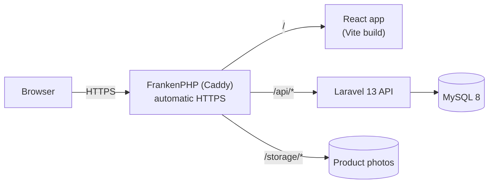

In production, one container serves both the React app and the API on the same address (no CORS), with HTTPS certificates handled automatically. MySQL isn't reachable from the internet.

## Tech stack

| Area | Tools |
|---|---|
| Frontend | React 19, React Router, Vite, Context API + custom hooks, plain CSS (brand design tokens) |
| Backend | Laravel 13, PHP 8.3, Sanctum (token auth), Eloquent, OpenSpout (Excel export) |
| Database | MySQL 8 (SQLite in tests) |
| DevOps | Docker Compose (dev + production), FrankenPHP/Caddy, GitHub Actions, nightly backup script |
| Quality | PHPUnit feature tests, oxlint |

## Run it locally

You only need **Docker**.

```bash
git clone git@github.com:mohamadayoobzawahir-png/yummiii.git
cd yummiii

# Laravel setup (first time only)
cp backend/.env.example backend/.env
docker compose run --rm --no-deps backend composer install
docker compose run --rm --no-deps backend php artisan key:generate
```

In `backend/.env`, set the database to the Docker MySQL:

```env
DB_CONNECTION=mysql
DB_HOST=mysql
DB_PORT=3306
DB_DATABASE=yummiii
DB_USERNAME=yummiii
DB_PASSWORD=secret
```

Then:

```bash
docker compose up -d                                         # first start: MySQL needs a few minutes
docker compose exec backend php artisan migrate --seed       # demo products + test admin
docker compose exec backend php artisan storage:link         # makes uploaded photos visible
```

| | |
|---|---|
| Shop | http://localhost:5173 |
| Admin | http://localhost:5173/admin/login, as `test@example.com` / `password` (local only) |
| API | http://localhost:8000/api/products |

## Tests

```bash
docker compose exec backend php artisan test
```

## Deployment

The live demo runs on **[Render](https://render.com)** (free plan) from [`render.yaml`](render.yaml):
every push to `main` redeploys it automatically. For a server of your own, see **[DEPLOY.md](DEPLOY.md)**: one command (`./deploy.sh`) on any Linux server with Docker, with automatic HTTPS and nightly backups.

## Project structure

```
backend/     Laravel API: routes/api.php, app/Http/Controllers, app/Models, tests/
frontend/    React app: src/pages, src/components, src/context, src/hooks
docker/      Development and production Docker files
docs/        Screenshots
```

## About

Yummiii is my sister's food business. I built this shop for her, and the
[live demo](https://yummiii-demo.onrender.com) runs the same code with sample data, so anyone can
explore the admin panel without seeing real customers.

Made by [@mohamadayoobzawahir-png](https://github.com/mohamadayoobzawahir-png).
